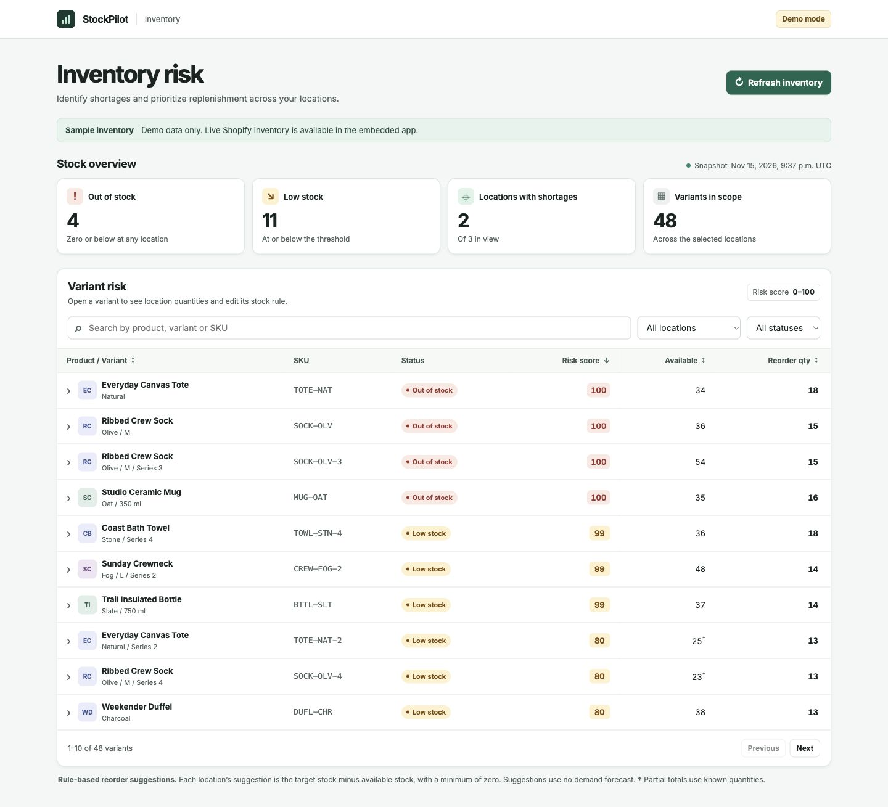
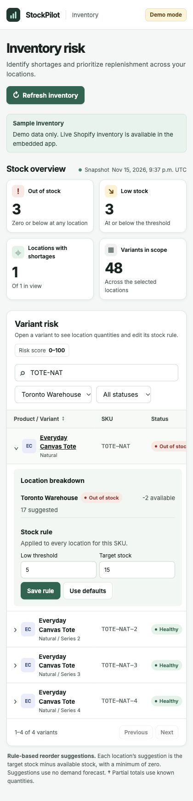

# StockPilot

StockPilot is an embedded Shopify Admin app for identifying out-of-stock and low-stock variants across active locations. Merchants can filter the risk table, expand a variant to see where it needs stock, and set a low-stock threshold and target for each SKU.

## Run the demo

Use Node.js 22.12 or later, preferably an LTS release, with npm. Run from the project directory in a POSIX shell.

```sh
npm ci
npm run demo
```

Open [http://localhost:3000/demo](http://localhost:3000/demo). The demo uses 48 synthetic variants and three locations, including negative, zero, missing and untracked quantities. The **Sample inventory** banner identifies the source. The route works in development mode on loopback only, uses `prisma/demo.sqlite`, and shares the pagination, caching and display code with the embedded app.





## Connect a Shopify development store

1. Sign in to Shopify with access to a Dev Dashboard organization, a development store, and an app in that organization.
2. Install dependencies, set a writable absolute SQLite path, and link the project.

   ```sh
   npm ci
   export DATABASE_URL="file:$PWD/prisma/dev.sqlite"
   npm run config:link
   ```

3. If linking rewrites the app configuration, preserve the linked app's identity and URLs. Copy the access scopes and webhook subscriptions from the supplied `shopify.app.toml` to the linked configuration. Keep the app embedded.
4. Run the development preview and select the development store. Shopify CLI generates the Prisma client and applies both migrations through `shopify.web.toml`.

   ```sh
   npm run dev
   ```

5. Install the app in the development store and open it from Shopify Admin. Compare a variant's location quantities to Shopify, save a SKU rule, then refresh after changing a quantity in the dev store. The first load creates a snapshot automatically. Subsequent visits use the saved snapshot.

Shopify CLI 4.9.5 was used to check scaffolding. Its noninteractive `app init` requires an organization ID or app client ID. This project uses Shopify's official React Router template at commit `81eb98b6ca095eb0b92657f6007939a418f61955`, downloaded directly because a Shopify account and dev store were unavailable. Embedded installation and stock-change refresh were verified manually on a Shopify dev store. Webhook delivery still needs a live check. [Official template](https://github.com/Shopify/shopify-app-template-react-router/tree/81eb98b6ca095eb0b92657f6007939a418f61955) · [Shopify CLI app init](https://shopify.dev/docs/api/shopify-cli/app/app-init) · [Shopify configuration](https://shopify.dev/docs/apps/build/cli-for-apps/manage-app-config-files)

### Access scopes

| Scope | Used for |
| --- | --- |
| `read_products` | Product and variant IDs, titles and SKUs |
| `read_inventory` | Tracking state, inventory levels and available quantities |
| `read_locations` | Active locations and their names |

The app asks for read-only Shopify scopes. Stock-rule changes write to SQLite. [Shopify access scopes](https://shopify.dev/docs/api/usage/access-scopes) · [Location access guide](https://shopify.dev/docs/apps/build/inventory-management-apps/migrate-to-read-locations)

### Hosting

Use a persistent writable volume for SQLite and run one Node server instance. Inject `SHOPIFY_API_KEY`, `SHOPIFY_API_SECRET`, `SHOPIFY_APP_URL`, `SCOPES`, and `DATABASE_URL` in the server environment. The database contains session credentials and should have the same access restrictions as other secrets. Apply migrations with `npm run setup`, build with `npm run build`, and serve with `npm start`. Configure the Shopify app to point at the HTTPS app URL. Use `npm run deploy` for Shopify app configuration updates. Host the Node server separately. [Shopify CLI deployment commands](https://shopify.dev/docs/api/shopify-cli/app)

## Risk and replenishment rules

The default low threshold is **5 units** and the default target is **15 units**. Expand a variant to save an override. A rule applies to each active location for the same exact SKU after trimming whitespace, including variants sharing that SKU. A blank SKU uses the defaults. Threshold and target must be whole numbers, threshold must be at least 1, and target must be at least the threshold.

| Available at a location | Status | Risk score |
| --- | --- | --- |
| Zero or negative | Out of stock | 100 |
| 1 through the low threshold | Low stock | `ceil(99 × (threshold − available + 1) / threshold)` |
| Above the low threshold | Healthy | 0 |
| Untracked inventory | Untracked | — |
| A missing item, location level or available quantity | Unavailable | — |

The all-location view shows each variant's worst known score and counts each variant once by that status. Availability and reorder totals sum the known locations. A dagger marks a partial total. Select a location to scope all rows and cards to that location. Search and status filters narrow the table. The **Locations with shortages** card counts locations with at least one out-of-stock or low-stock variant.

Suggested reorder quantity per location is `max(0, targetStock − availableStock)`, including locations above the low threshold and below the target. For example, −2 available and a target of 15 yields 17 suggested. These are rule-based suggestions. The calculation uses no demand forecast.

## Architecture

- **Shopify authentication.** The template's React Router package manages auth, App Bridge, session-token exchange and Prisma session storage. Each live loader and action authenticates independently. The server uses the verified session's shop key and authenticated Admin client. The client receives inventory, rule values, timestamps and App Bridge's public client ID. Secrets and Admin access tokens stay on the server.
- **GraphQL reads.** Admin API version **2026-07**. Cursor-page active locations in batches of 100 and product variants in batches of 35. Each variant page includes its product and inventory item, plus up to eight inventory levels sized to the shop's active location count. Follow an inventory item's remaining level cursor until exhausted. Match levels by location ID and read only `quantities(names: ["available"])`. [Product variants](https://shopify.dev/docs/api/admin-graphql/latest/queries/productVariants) · [Locations](https://shopify.dev/docs/api/admin-graphql/2026-07/queries/locations) · [Inventory item](https://shopify.dev/docs/api/admin-graphql/2026-07/objects/InventoryItem) · [Inventory level](https://shopify.dev/docs/api/admin-graphql/2026-07/objects/InventoryLevel)
- **Failure handling.** Reject partial GraphQL data and stalled cursors. Serialize Shopify requests within a shop refresh, pace using reported GraphQL query cost and the remaining throttle budget, and retry throttling and transient errors with bounded backoff. Honor `Retry-After` when the client exposes it. Requests have a 15-second timeout and the fetch has a two-minute deadline. Merchant-facing errors omit upstream details. [Shopify API limits](https://shopify.dev/docs/api/usage/limits)
- **SQLite snapshots.** Store one complete snapshot per shop with an atomic upsert and a completion timestamp. Overlapping refreshes for the same shop share a request within a process. A failed refresh preserves the previous snapshot and timestamp. A snapshot older than 30 minutes shows a stale banner. The app refreshes on first access or the merchant's request. Rules are stored separately, so rule changes recalculate the existing snapshot without calling Shopify. Authenticated uninstall webhooks remove the shop's sessions, rules and snapshot.
- **Dashboard.** A streamed loader provides the loading state. React renders a responsive summary and a searchable, sortable, paginated table. Expanded rows expose the location details and rule editor. The table scrolls horizontally on narrow screens. Inventory responses use private, no-store HTTP caching.

## Tests

```sh
npm ci
npm exec prisma generate
npm test
npm run typecheck
npm run build
npm audit
```

Ten automated tests cover risk and reorder boundary cases, SKU overrides, missing and untracked quantities, all three cursor loops, invalid cursors, SDK throttling, transient and permanent API failures, partial API responses, and a real temporary SQLite database with cold and warm reads, failed refresh preservation, concurrent request coalescing and tenant isolation. Local browser checks exercised manual refresh, location and search filters, SKU rule editing and reset, sorting, pagination, an empty search and a 420-pixel-wide layout.

### Automated inventory refresh

**StockPilot CI** runs type checking, the build and the npm test suite on pushes and pull requests. The refresh regression test supplies simulated Shopify GraphQL responses and exercises the same dashboard loader, manual refresh action and SQLite snapshot used by the embedded app. It checks that a warm load still shows 0 available after the upstream quantity changes, then verifies that refresh shows **3 available**, **Low stock**, **risk 60** and **12 suggested**.

### Live Shopify dev-store test

The live test runs the same server-side scenario against real Shopify Admin GraphQL 2026-07 data in a temporary SQLite database. It verifies refresh and calculation at the service layer. The embedded browser and App Bridge login are covered by the manual checks above.

1. In your Shopify organization, create a separate test app and install it only on your development store. Give it `read_products,read_inventory,read_locations,write_inventory` using the Shopify Dev Dashboard. Configure client credentials for the test app. The StockPilot app configuration remains read-only. [Shopify client credentials setup](https://shopify.dev/docs/apps/build/authentication-authorization/client-credentials-grant)
2. Create a dedicated tracked test variant with SKU `STOCKPILOT-E2E`, activate it at an active test location, and set **Available** to **0**. Use the canonical `myshopify.com` domain and GraphQL IDs for that variant and location.
3. Set GitHub Actions repository variables `STOCKPILOT_TEST_SHOP`, `STOCKPILOT_TEST_VARIANT_ID` (in the form `gid://shopify/ProductVariant/123`), and `STOCKPILOT_TEST_LOCATION_ID` (in the form `gid://shopify/Location/456`). Add the separate test app's client ID and client secret as Actions secrets named `STOCKPILOT_TEST_CLIENT_ID` and `STOCKPILOT_TEST_CLIENT_SECRET`.
4. Once the workflow is on the default branch, open **Actions → Shopify dev-store refresh test → Run workflow**. For a local run, supply the same five values as environment variables and run `npm run test:dev-store` after generating the Prisma client.

The script checks the shop's dev-store flag and fixture SKU before writing. It uses a compare-and-swap adjustment to change 0 to 3 and restores 0 in cleanup. GitHub serializes live workflow runs. If a job is forcibly stopped or Shopify is unavailable during cleanup, verify the fixture is back at 0 before rerunning. [Shopify inventory adjustments](https://shopify.dev/docs/api/admin-graphql/2026-07/mutations/inventoryAdjustQuantities)

## Dashboard load benchmark

Run `npm run benchmark` after generating the Prisma client. The script starts a local React Router development server on port 4174, uses a temporary SQLite database, and sends HTTP requests to the dashboard. It seeds the same **1,050 variants across 3 locations** on every run. The deterministic GraphQL fixture adds **10 ms per request**, with 30 variant pages and one location page per cold load.

After two untimed startup requests, it measures 20 paired loads. The script deletes the snapshot before each cold request and immediately requests the same dashboard again for the warm measurement. It checks that the cold request persisted all 1,050 variants and that the warm request preserved the snapshot timestamp. It reports nearest-rank percentiles. First byte is measured when fetch resolves with response headers. Completion includes fetching the entire streamed HTML body.

Measured locally on arm64 macOS 14.8.4, Node.js 23.7.0, with 20 pairs. All times are milliseconds.

| SQLite cache | First byte p50 | First byte p95 | Full response p50 | Full response p95 |
| --- | ---: | ---: | ---: | ---: |
| Cold | 3.81 | 5.91 | 409.20 | 418.47 |
| Warm | 4.80 | 5.63 | 16.65 | 18.16 |

The warm snapshot reduced median full-response time by about **96%** in this fixture. The benchmark excludes Shopify authentication, live network/API latency, throttle pacing from real Shopify cost data, and browser hydration. The cold shell streams before inventory completes.

## Known limitations

- The app scans inventory within a single request. Shopify throttling, locations with many inventory-level pages, the two-minute sync deadline, and Shopify's connection limits bound the practical catalog size. Very large catalogs would require a background bulk sync and server-side table paging.
- A cursor scan can overlap live stock movements. The timestamp records scan completion. Warm loads display that snapshot until the merchant refreshes.
- The app scores tracked quantities at active locations Shopify returns. It has no purchase order, transfer, incoming-stock, sales-rate, or lead-time inputs.
- The SQLite design targets one server instance. Shopify App Store distribution would require the mandatory privacy webhook subscriptions and an App Store review.
- In the local macOS sandbox, Prisma's schema engine occasionally returned an empty error. Using an absolute database path and retrying with `RUST_LOG=debug` allowed migrations to run.
